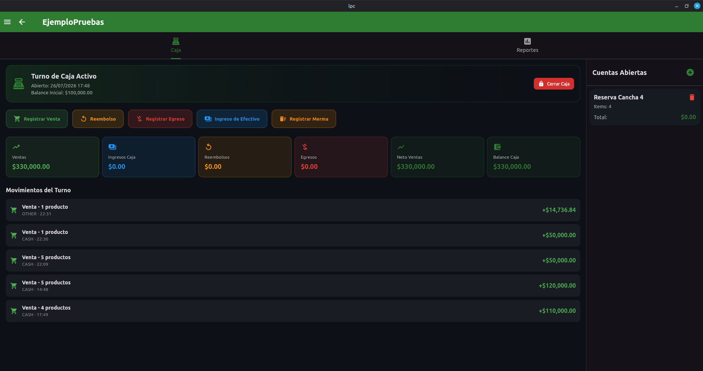
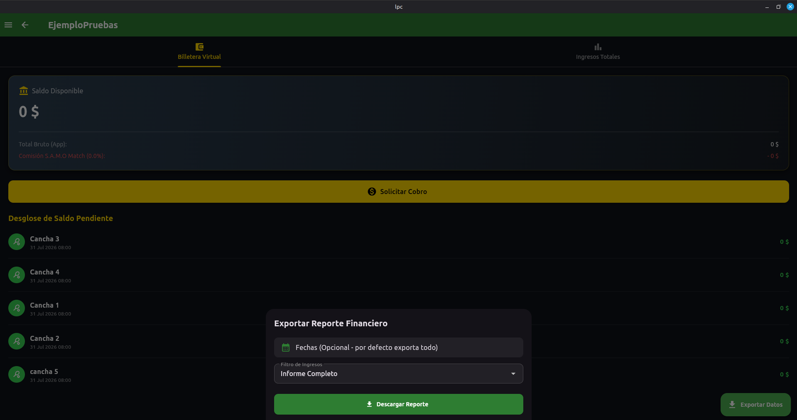
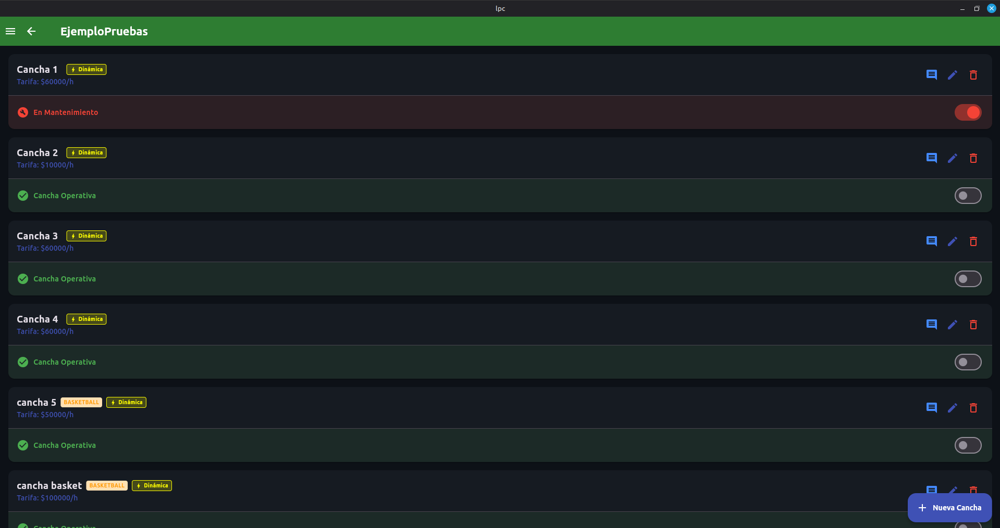
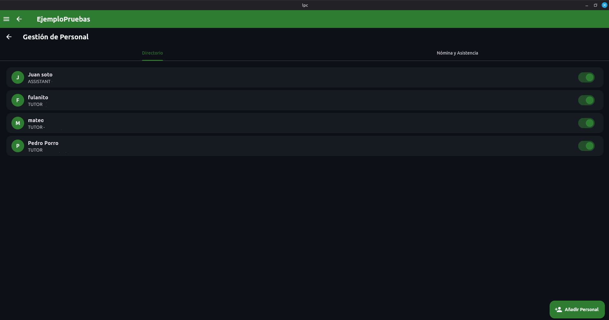
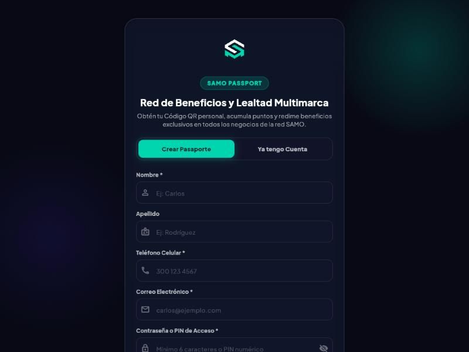
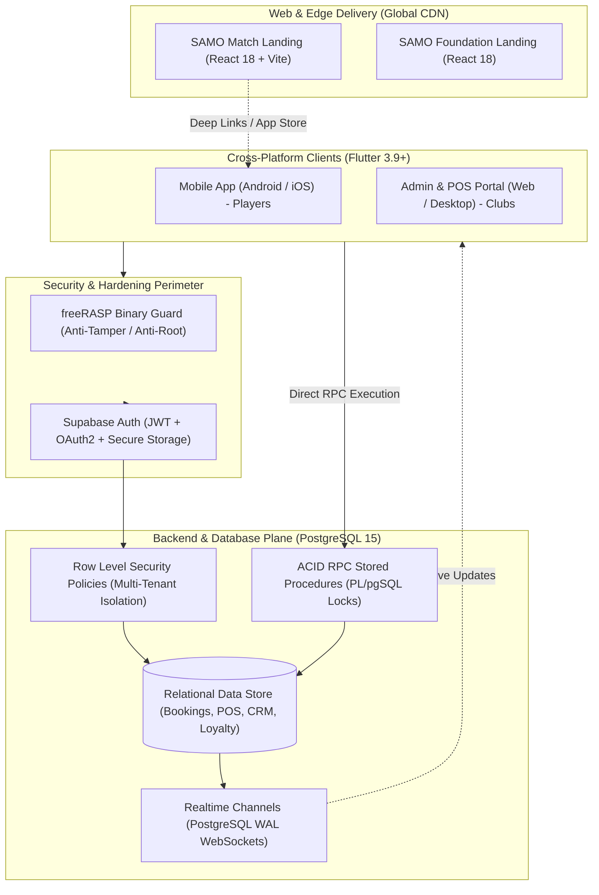
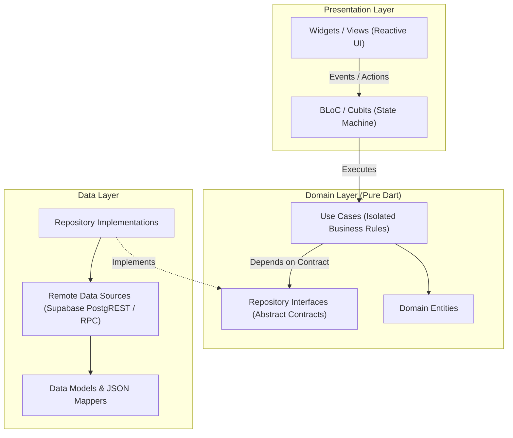

# SAMO — Sports League, Club ERP & Enterprise POS Ecosystem

<div align="center">


### *Mission-Critical Multiplatform Architecture & Technical Case Study*

<br/>

[](https://flutter.dev)
[](https://dart.dev)
[](https://react.dev)
[](https://supabase.com)
[](#system-architecture--design-patterns)
[](#7-devsecops-mobile-app-hardening-rasp-and-multi-tenant-rls)
[](#tech-stack-and-dependencies)

<br/>

**An enterprise-grade, high-concurrency multiplatform ecosystem engineered for competitive sports leagues, dynamic ELO matchmaking, automated tournament brackets, real-time facility bookings, and an integrated Point of Sale (POS) & ERP subsystem.**

<sub>Proprietary product developed and maintained by **[SAMO Enterprises](https://samoenterprises.site/)**.</sub><br/>
<sub>*Note: This repository serves as a public architectural showcase, system design case study, and portfolio showcase. Commercial backend secrets, client databases, and proprietary algorithms are protected.*</sub>

---

</div>

## 📑 Table of Contents
- [Executive Overview](#executive-overview)
- [SAMO Modules](#samo-modules)
- [Codebase at a Glance](#codebase-at-a-glance)
- [Visual Product Showcase](#visual-product-showcase)
- [System Architecture & Design Patterns](#system-architecture--design-patterns)
  - [High-Level Ecosystem Topology](#high-level-ecosystem-topology)
  - [Clean Architecture & Layered Decoupling](#clean-architecture--layered-decoupling)
- [Core Engineering Innovations](#core-engineering-innovations)
  - [1. Real-Time Concurrency & ACID Integrity (PostgreSQL RPCs)](#1-real-time-concurrency--acid-integrity-postgresql-rpcs)
  - [2. Multi-Tender POS & Blind Cash Reconciliation](#2-multi-tender-pos--blind-cash-reconciliation)
  - [3. SAMO Customers: Business Alliance Network & Loyalty Passport](#3-samo-customers-business-alliance-network--loyalty-passport)
  - [4. Tournament Engine & Bracket Generation Math](#4-tournament-engine--bracket-generation-math)
  - [5. Dynamic ELO & League Points (LP) Matchmaking](#5-dynamic-elo--league-points-lp-matchmaking)
  - [6. Shadow Testing: The Scientist Pattern](#6-shadow-testing-the-scientist-pattern)
  - [7. DevSecOps: Mobile App Hardening (RASP) & Multi-Tenant RLS](#7-devsecops-mobile-app-hardening-rasp--multi-tenant-rls)
  - [8. Modular Licensing: Per-Club Feature Entitlements](#8-modular-licensing-per-club-feature-entitlements)
  - [9. Platform Operations: Service Suspension & Notices](#9-platform-operations-service-suspension--notices)
  - [10. Verified Payments & Scheduled Email Reports](#10-verified-payments--scheduled-email-reports)
  - [11. Architecture Rules as Automated Tests](#11-architecture-rules-as-automated-tests)
- [Tech Stack and Dependencies](#tech-stack-and-dependencies)
- [Quality Assurance and Testing Strategy](#quality-assurance-and-testing-strategy)
- [Engineering Roadmap & Scalability Milestones](#engineering-roadmap--scalability-milestones)
- [Author & Professional Inquiries](#author--professional-inquiries)

---

## Executive Overview

**SAMO** unifies high-engagement consumer experiences with mission-critical facility operations in a cohesive multi-platform ecosystem:

```text
+----------------------------------------------------------------------------------------+
|                                    SAMO ECOSYSTEM                                      |
+-------------------------------------------+--------------------------------------------+
|        B2C: PLAYER & CONSUMER APP         |          B2B: CLUB & FACILITY ERP          |
|  - Dynamic ELO & LP Ladder Rankings       |  - High-Concurrency Multi-Terminal POS     |
|  - Automated Tournament Brackets          |  - Blind Cash Count & Shift Reconciliation |
|  - Real-Time Court / Barber Reservations  |  - Split Payments & App Account Bypass     |
|  - Optical QR Coupon & Wallet Redemption  |  - Staff & Instructor Payroll Engine       |
|  - Multi-Sport Theming (Padel, Tennis...) |  - Live Financial Auditing & Excel Exports |
+-------------------------------------------+--------------------------------------------+
|                            MODERN WEB & EDGE LANDINGS                                  |
|  - React 18 + Vite Micro-Frontend architecture with Framer Motion visual physics        |
|  - Global CDN edge caching (< 50ms latency) & Universal App Store deep linking        |
+----------------------------------------------------------------------------------------+
```

---

## SAMO Modules

SAMO is a modular platform: every module works on its own and integrates with the others, so a business adopts only what it needs.

| Module | What it does | Typical users |
| :--- | :--- | :--- |
| **Bookings & Agenda** | Real-time scheduling grid for courts, rooms, tables and staff, with conflict detection, holds, breaks and recurring series. | Sports clubs, barbershops, salons, restaurants, studios |
| **Services & Appointments** | Service catalog, combos, per-professional schedules, commissions and tips. | Barbershops, spas, clinics, academies |
| **POS & ERP** | Multi-terminal point of sale, split tenders, blind cash reconciliation, inventory, payroll, expenses and accounting reports. | Any small or mid-size business |
| **Tournaments & Rankings** | Automated brackets, result voting, ELO and league points across several sports. | Clubs, leagues, academies |
| **SAMO Customers** | Independent alliance network for small and mid-size businesses: loyalty passport, shared offers, negotiated deals between brands and a cashier module with full audit. | Any business, with or without the rest of SAMO |
| **Landing & Foundation sites** | Fast edge-delivered public sites for each brand and for the community programs. | Brands and communities |

Modules are decoupled by design: using one never forces a business to use another, but they synchronize when both are present (for example, the POS reads and redeems Customers coupons at checkout).

---

## Codebase at a Glance

Hand-written code only (non-blank lines; generated files, build output, dependencies, documentation and one-off maintenance scripts excluded). Measured October 2026.

| Language | Lines | Files | Where it lives |
| :--- | ---: | ---: | :--- |
| **Dart** (application) | ~188,000 | ~900 | Flutter clients: mobile, web admin/POS, desktop |
| **Dart** (tests) | ~27,000 | ~300 | Unit, BLoC, widget, data-source and architecture-rule tests |
| **CSS / HTML / JavaScript** | ~16,000 | ~160 | React + Vite landings and public pages |
| **SQL** | ~5,000 | ~46 | Versioned PostgreSQL scripts: schema, RLS, RPCs, hardening |
| **TypeScript** | ~2,000 | 14 | Supabase Edge Functions (payments, e-mail reports) |
| **Total** | **~239,000** | **~1,400** | |

*Line counts are a measure of scope, not of quality: the emphasis of this project is on architecture, security and test coverage, described below.*

---

## Visual Product Showcase

| Enterprise POS & Split Tender | Club Admin Dashboard |
| :---: | :---: |
|  |  |
| *Multi-tender split payments (Cash, Cards, Transfers, In-App).* | *Real-time occupancy tracking, metrics & cashflow health.* |

| Court & Facility Reservation Grid | Staff Payroll & Commission Engine |
| :---: | :---: |
|  |  |
| *Real-time visual schedule with conflict detection & holds.* | *Automated commission calculation and instructor payouts.* |

| SAMO Customers: Loyalty Passport |
| :---: |
|  |
| *Phone-based sign-up that issues a permanent personal QR for the whole alliance network.* |

---

## System Architecture & Design Patterns

### High-Level Ecosystem Topology

The system separates high-traffic public web assets from private operational clients, all powered by a centralized relational data plane:



### Clean Architecture & Layered Decoupling

The Flutter codebase enforces strict **Clean Architecture** combined with **BLoC** (Business Logic Component) pattern:



* **Deterministic Functional Error Handling:** Uses `dartz` algebraic data types (`Either<Failure, T>`). UI components never receive uncaught exceptions; errors are first-class functional values.
* **Inversion of Control (IoC):** Service Locator pattern using `GetIt` with lazy singletons and factories, allowing 100% mocked isolation in test harnesses.

---

## Core Engineering Innovations

### 1. Real-Time Concurrency & ACID Integrity (PostgreSQL RPCs)
* **Challenge:** High-traffic tournament registrations and peak reservation windows create critical race conditions (two players booking the same slot or two cashiers updating the same register).
* **Engineering Solution:** Implemented atomic stored procedures (**PL/pgSQL RPCs**) executed with explicit row-level locks (`SELECT FOR UPDATE`):
  * `update_shift_expected_balance()`: Computes register balances atomically without dirty reads.
  * `create_cart_hold()` & `book_court_slot()`: Guarantees mutual exclusion and rollback mechanisms on concurrent slot allocation.

### 2. Multi-Tender POS & Blind Cash Reconciliation
* **Multi-Modal Split Payments:** High-concurrency checkout engine supporting complex multi-tender transactions across Cash, Debit/Credit Cards, Digital Wallets (Nequi/Daviplata), and Customer In-App Account Bypass.
* **Blind Cash Counting (Shrinkage Prevention):** Cashiers submit end-of-shift physical counts blindly without seeing system balances. Discrepancies are logged in audit tables for management review.
* **Optical Hardware Stream:** Real-time barcode and QR code reading via camera streams with haptic confirmation.

### 3. SAMO Customers: Business Alliance Network & Loyalty Passport
SAMO Customers connects small and mid-size businesses in growing cities into an alliance network where brands trade benefits and learn about their customers with consent. It is a standalone product that is fully compatible with the SAMO POS and ERP, and neither requires the other.

* **Passport & permanent QR:** A customer signs up with a phone number and receives one random, 128-bit, permanent QR. The QR never changes; security comes from the customer confirming every coupon redemption in their own app (a request that expires in minutes), so a copied QR cannot spend anything.
* **Alliances without intermediaries:** Two businesses propose, counter-propose and accept a deal directly. Every change is stored as an immutable version, and a deal only takes effect when both parties accept.
* **Absolute per-brand privacy:** Row-Level Security and `SECURITY DEFINER` RPCs ensure each brand sees only its own customers, offers and history. Businesses never receive the customer's QR or login identity.
* **Cashier & team module with full audit:** Owner, manager and cashier roles, invitations, rate-limited scanning and an immutable access log that records who scanned whom and when.
* **Immutable loyalty ledger:** Points are credited by a database trigger on POS sales (idempotent, refund-aware) and can never block or break a sale.
* **Realtime instead of polling:** Redemption approvals and deal updates are pushed over private Realtime channels, keeping request volume low enough for a free-tier database.
* **Built for scale on small budgets:** Offers are materialized only when a customer is scanned, old records are purged on a schedule, and hot paths are indexed.

### 4. Tournament Engine & Bracket Generation Math
* **Automated Tournament Generator:** Recursive bracket generation algorithm supporting Single Elimination, Double Elimination, Round Robin, and "Americano" mixed rotation.
* **Consensus-Driven Result Voting:** Multi-party match result validation with automated consensus triggers when both opposing parties submit matching scores.

### 5. Dynamic ELO & League Points (LP) Matchmaking
* Adapted competitive chess ELO rating mathematics for multi-sport singles and doubles:
  $$\Delta R = K \cdot (S - E)$$
* Features competitive tiers (Iron through Grand Athlete), placement match calibration, inactivity decay, and tiered promotion/relegation series.

### 6. Shadow Testing: The Scientist Pattern
* **Zero-Downtime Refactoring:** Integrated an in-house implementation of the **Scientist Pattern** (`scientist_service.dart`) inspired by GitHub and Stripe.
* During high-risk financial migrations, the system executes both legacy and refactored algorithms simultaneously in the background, logging deviations to audit collectors without impacting production users.

### 7. DevSecOps: Mobile App Hardening (RASP) & Multi-Tenant RLS
* **Binary Runtime Self-Protection (freeRASP):** Detects rooted/jailbroken devices, reverse-engineering frameworks (Frida, Xposed), debuggers, and application tampering.
* **Multi-Tenant Row-Level Security (RLS):** Row-Level Security is enabled on every PostgreSQL table, and the loyalty and alliance tables enforce per-brand isolation through policies based on the authenticated user and business membership.
* **Staging parity:** Every schema change is first validated against a separate QA project and then applied to production from the same migration file, with SQL tests that run inside rolled-back transactions.
* **Privacy enforced by the database, not the UI:** sensitive columns (who booked a slot, billing data, integration tokens) are protected with column-level grants and `SECURITY DEFINER` functions that return only what the caller is allowed to see. The client never receives data it should not show.
* **Staged, reversible hardening:** every security change is written as a versioned SQL script, applied first to an isolated QA project, then verified in production with read-only simulations that roll back (impersonating real roles) before and after the change.

### 8. Modular Licensing: Per-Club Feature Entitlements
* Every business capability (agenda, POS, inventory, tournaments, CRM, finance, payroll, e-mail reports, matchmaking...) is a **separate module** in a catalog with declared dependencies.
* A platform super-admin switches each module **Active / Trial (with expiry) / Off** per club. Turning a module off cascades to the modules that depend on it; turning one on activates its prerequisites in order, always with a confirmation step.
* **Two-key access rule:** a screen is visible only if the *club has the module* **and** the *person has the permission* (`DashboardAccess`, a pure-Dart domain service, 100% unit-tested).
* Enforced **server-side** too (RLS policies call `club_has_module`), so a modified client cannot reach a module the club does not have. The client fails open on network errors so a connectivity blip never locks a business out.

### 9. Platform Operations: Service Suspension & Notices
* Super-admins can **suspend a club** (all of its staff lose access, enforced in the database membership functions) and reactivate it, and can broadcast a **service notice banner** (info / warning / critical colour levels, contrast-checked for accessibility) that the club sees across the app.
* Changes go through audited RPCs; the client polls with a conservative interval and keeps the last known state on failure.

### 10. Verified Payments & Scheduled Email Reports
* **Online payments:** Wompi webhook handler validating the event **SHA-256 checksum**, with a polling fallback (`verify-payment`) and strict separation of test and production environments and secrets.
* **E-mail reports per club:** each business chooses its own recipients (max. 3, double opt-in link) and receives an executive workbook and a raw balance workbook (sales, waste, expenses, barber/instructor performance). Implemented as Deno Edge Functions with their own automated test suite and a mutation check on the critical validations.

### 11. Architecture Rules as Automated Tests
* `layer_rules_test.dart` scans the codebase and **fails the build** if the domain layer imports Flutter, Supabase or presentation code, or if presentation reaches into the data layer. Pre-existing exceptions are frozen in an explicit allow-list so the debt can only shrink.
* Features such as `club_service`, `club_modules` and the super-admin module manager were built to this rule from the first commit.

---

## Tech Stack and Dependencies

| Domain | Technology | Key Capabilities |
| :--- | :--- | :--- |
| **Mobile & Desktop** | **Flutter 3.9+ / Dart 3.9+** | High-performance multiplatform client engine |
| **Web Frontends** | **React 18, Vite, Framer Motion** | Ultra-lightweight landing pages with physics animations |
| **State Management** | **flutter_bloc 8.1, Equatable** | Deterministic, event-driven state orchestration |
| **Architecture** | **get_it, dartz** | Dependency injection & functional programming (`Either`) |
| **Backend & Cloud** | **Supabase (PostgreSQL 15)** | Row Level Security, Realtime WebSockets, Storage, RPCs |
| **Mobile Hardening** | **freeRASP, flutter_dotenv** | Binary integrity, anti-tampering, environment isolation |
| **Optical & Hardware**| **mobile_scanner, geolocator** | Real-time QR scanning and location-based verification |
| **Data Streaming** | **excel, csv, file_saver** | Asynchronous client-side report generation |
| **Testing & QA** | **mocktail, bloc_test** | Unit testing, BLoC mock verification, coverage tooling |

---

## Quality Assurance and Testing Strategy

The repository follows a rigorous multi-tier testing pyramid:

```text
    ▲
   / \     End-to-End Integration Tests (Booking & POS critical paths)
  /───\    
 /     \   BLoC & UseCase State Transition Tests (mocktail, bloc_test)
/───────\  
---------  Pure Unit & Mathematical Tests (ELO formulas, bracket math, parsers)
```

* **1,400+ automated tests** (unit, BLoC/Cubit, widget, data-source and architecture rules) plus Deno tests for Edge Functions.
* **BLoC Stream Testing:** Verified state emissions under simulated network latency and infrastructure failures.
* **SQL Behaviour Tests:** Database functions and policies are tested in rolled-back transactions (isolation between brands, atomic redemptions, immutable ledgers, scan limits).
* **In-Memory Backend for Tests:** A fake PostgREST backend lets data sources and end-to-end flows run without touching any real database.
* **Static Code Analysis:** Strict lint rules enforced via continuous integration pipelines.
* **CI Quality Gates:** Automated GitHub Actions workflows validating linting, testing, and bundle builds on every PR.

---

## Engineering Roadmap & Scalability Milestones

The architectural evolution of the SAMO ecosystem focuses on mission-critical throughput, offline resilience, and enterprise club scaling:

- [x] **Distributed Multi-Tender POS:** Sub-second transactional processing with blind shift reconciliation.
- [x] **Real-Time Tournament Orchestrator:** Dynamic bracket seeding and live match progression via WebSockets.
- [x] **Scientist Pattern Integration:** Shadow-routing financial calculations to ensure zero regressions during schema migrations.
- [x] **DevSecOps RASP Hardening:** Native anti-tampering and jailbreak/root verification at runtime.
- [x] **SAMO Customers Alliance Network:** Loyalty passport, confirmed redemptions, negotiated deals between brands and audited cashier module.
- [x] **Per-Club Module Licensing:** Catalog, dependencies, trials and server-side enforcement.
- [x] **Platform Operations Console:** Club suspension, colour-coded service notices, audited super-admin RPCs.
- [x] **Verified Online Payments & E-mail Reports:** Signed webhooks, test/production isolation, per-club report recipients.
- [x] **Automated Architecture Guardrails:** Layer rules enforced by the test suite.
- [ ] **Offline-First Synchronization Engine:** Local-first SQLite/Drift state persistence with differential sync replay for intermittent club network conditions.
- [ ] **Multi-Region Read Replicas:** Geographically distributed database read caching for sub-50ms analytics query latency.
- [ ] **Micro-Frontend Admin Matrix:** Isolated federated dashboards for multi-tenant enterprise franchise management.

---

## Author & Professional Inquiries

Architected and developed by **Nicolás León** — Systems Engineer & Software Architect.

* **GitHub Organization:** [@SAMOenterprises](https://github.com/SAMOenterprises)
* **Personal GitHub:** [@Nicolas11Leon](https://github.com/Nicolas11Leon)
* **Official Website:** [samoenterprises.site](https://samoenterprises.site/)
* **Direct Email:** [leonparranicolas@gmail.com](mailto:leonparranicolas@gmail.com)

---

<div align="center">
  <sub>Engineered with Clean Architecture, mathematical precision, and enterprise rigor. © 2026 SAMO Enterprises.</sub>
</div>
