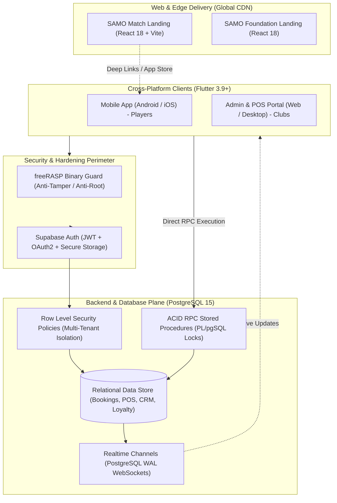
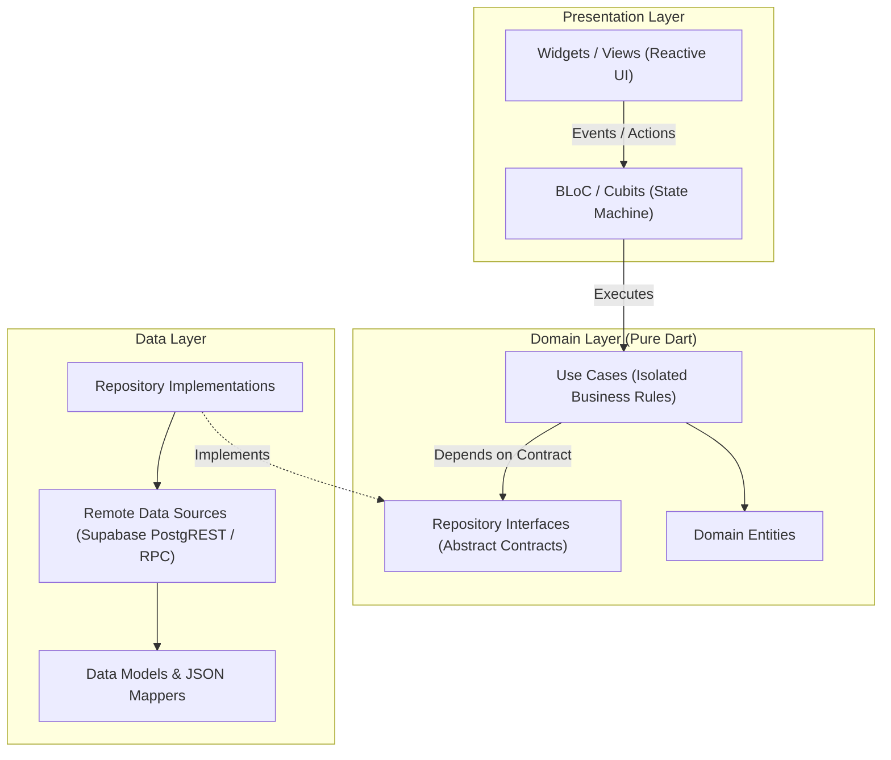

# SAMO — Sports League, Club ERP & Enterprise POS Ecosystem

<div align="center">


### *Mission-Critical Multiplatform Architecture & Technical Case Study*

<br/>

[](https://flutter.dev)
[](https://dart.dev)
[](https://react.dev)
[](https://supabase.com)
[](#system-architecture--design-patterns)
[](#7-devsecops-mobile-app-hardening-rasp-and-multi-tenant-rls)
[](#tech-stack-and-dependencies)

<br/>

**An enterprise-grade, high-concurrency multiplatform ecosystem engineered for competitive sports leagues, dynamic ELO matchmaking, automated tournament brackets, real-time facility bookings, and an integrated Point of Sale (POS) & ERP subsystem.**

<sub>Proprietary product developed and maintained by **[SAMO Enterprises](https://samoenterprises.site/)**.</sub><br/>
<sub>*Note: This repository serves as a public architectural showcase, system design case study, and portfolio showcase. Commercial backend secrets, client databases, and proprietary algorithms are protected.*</sub>

---

</div>

## 📑 Table of Contents
- [Executive Overview](#executive-overview)
- [Visual Product Showcase](#visual-product-showcase)
- [System Architecture & Design Patterns](#system-architecture--design-patterns)
  - [High-Level Ecosystem Topology](#high-level-ecosystem-topology)
  - [Clean Architecture & Layered Decoupling](#clean-architecture--layered-decoupling)
- [Core Engineering Innovations](#core-engineering-innovations)
  - [1. Real-Time Concurrency & ACID Integrity (PostgreSQL RPCs)](#1-real-time-concurrency--acid-integrity-postgresql-rpcs)
  - [2. Multi-Tender POS & Blind Cash Reconciliation](#2-multi-tender-pos--blind-cash-reconciliation)
  - [3. SAMO Clients: Cross-Brand Loyalty & Optical QR Engine](#3-samo-clients-cross-brand-loyalty--optical-qr-engine)
  - [4. Tournament Engine & Bracket Generation Math](#4-tournament-engine--bracket-generation-math)
  - [5. Dynamic ELO & League Points (LP) Matchmaking](#5-dynamic-elo--league-points-lp-matchmaking)
  - [6. Shadow Testing: The Scientist Pattern](#6-shadow-testing-the-scientist-pattern)
  - [7. DevSecOps: Mobile App Hardening (RASP) & Multi-Tenant RLS](#7-devsecops-mobile-app-hardening-rasp--multi-tenant-rls)
- [Tech Stack and Dependencies](#tech-stack-and-dependencies)
- [Quality Assurance and Testing Strategy](#quality-assurance-and-testing-strategy)
- [Author & Professional Inquiries](#author--professional-inquiries)

---

## Executive Overview

**SAMO** unifies high-engagement consumer experiences with mission-critical facility operations in a cohesive multi-platform ecosystem:

```text
+----------------------------------------------------------------------------------------+
|                                    SAMO ECOSYSTEM                                      |
+-------------------------------------------+--------------------------------------------+
|        B2C: PLAYER & CONSUMER APP         |          B2B: CLUB & FACILITY ERP          |
|  - Dynamic ELO & LP Ladder Rankings       |  - High-Concurrency Multi-Terminal POS     |
|  - Automated Tournament Brackets          |  - Blind Cash Count & Shift Reconciliation |
|  - Real-Time Court / Barber Reservations  |  - Split Payments & App Account Bypass     |
|  - Optical QR Coupon & Wallet Redemption  |  - Staff & Instructor Payroll Engine       |
|  - Multi-Sport Theming (Padel, Tennis...) |  - Live Financial Auditing & Excel Exports |
+-------------------------------------------+--------------------------------------------+
|                            MODERN WEB & EDGE LANDINGS                                  |
|  - React 18 + Vite Micro-Frontend architecture with Framer Motion visual physics        |
|  - Global CDN edge caching (< 50ms latency) & Universal App Store deep linking        |
+----------------------------------------------------------------------------------------+
```

---

## Visual Product Showcase

| Enterprise POS & Split Tender | Club Admin Dashboard |
| :---: | :---: |
|  |  |
| *Multi-tender split payments (Cash, Cards, Transfers, In-App).* | *Real-time occupancy tracking, metrics & cashflow health.* |

| Court & Facility Reservation Grid | Staff Payroll & Commission Engine |
| :---: | :---: |
|  |  |
| *Real-time visual schedule with conflict detection & holds.* | *Automated commission calculation and instructor payouts.* |

---

## System Architecture & Design Patterns

### High-Level Ecosystem Topology

The system separates high-traffic public web assets from private operational clients, all powered by a centralized relational data plane:



### Clean Architecture & Layered Decoupling

The Flutter codebase enforces strict **Clean Architecture** combined with **BLoC** (Business Logic Component) pattern:



* **Deterministic Functional Error Handling:** Uses `dartz` algebraic data types (`Either<Failure, T>`). UI components never receive uncaught exceptions; errors are first-class functional values.
* **Inversion of Control (IoC):** Service Locator pattern using `GetIt` with lazy singletons and factories, allowing 100% mocked isolation in test harnesses.

---

## Core Engineering Innovations

### 1. Real-Time Concurrency & ACID Integrity (PostgreSQL RPCs)
* **Challenge:** High-traffic tournament registrations and peak reservation windows create critical race conditions (two players booking the same slot or two cashiers updating the same register).
* **Engineering Solution:** Implemented atomic stored procedures (**PL/pgSQL RPCs**) executed with explicit row-level locks (`SELECT FOR UPDATE`):
  * `update_shift_expected_balance()`: Computes register balances atomically without dirty reads.
  * `create_cart_hold()` & `book_court_slot()`: Guarantees mutual exclusion and rollback mechanisms on concurrent slot allocation.

### 2. Multi-Tender POS & Blind Cash Reconciliation
* **Multi-Modal Split Payments:** High-concurrency checkout engine supporting complex multi-tender transactions across Cash, Debit/Credit Cards, Digital Wallets (Nequi/Daviplata), and Customer In-App Account Bypass.
* **Blind Cash Counting (Shrinkage Prevention):** Cashiers submit end-of-shift physical counts blindly without seeing system balances. Discrepancies are logged in audit tables for management review.
* **Optical Hardware Stream:** Real-time barcode and QR code reading via camera streams with haptic confirmation.

### 3. SAMO Clients: Cross-Brand Loyalty & Optical QR Engine
* **Commercial Brand Partnerships:** Allows facility administrators to configure commercial alliances (e.g., sports equipment brands, barbering chains, nutrition partners) with custom discount rules and point redemption ratios.
* **Partner Scanner Application:** Partner establishments verify and redeem user coupons in real-time via camera scanning, with instant atomic status updates and fraud prevention.

### 4. Tournament Engine & Bracket Generation Math
* **Automated Tournament Generator:** Recursive bracket generation algorithm supporting Single Elimination, Double Elimination, Round Robin, and "Americano" mixed rotation.
* **Consensus-Driven Result Voting:** Multi-party match result validation with automated consensus triggers when both opposing parties submit matching scores.

### 5. Dynamic ELO & League Points (LP) Matchmaking
* Adapted competitive chess ELO rating mathematics for multi-sport singles and doubles:
  $$\Delta R = K \cdot (S - E)$$
* Features competitive tiers (Iron through Grand Athlete), placement match calibration, inactivity decay, and tiered promotion/relegation series.

### 6. Shadow Testing: The Scientist Pattern
* **Zero-Downtime Refactoring:** Integrated an in-house implementation of the **Scientist Pattern** (`scientist_service.dart`) inspired by GitHub and Stripe.
* During high-risk financial migrations, the system executes both legacy and refactored algorithms simultaneously in the background, logging deviations to audit collectors without impacting production users.

### 7. DevSecOps: Mobile App Hardening (RASP) & Multi-Tenant RLS
* **Binary Runtime Self-Protection (freeRASP):** Detects rooted/jailbroken devices, reverse-engineering frameworks (Frida, Xposed), debuggers, and application tampering.
* **Multi-Tenant Row-Level Security (RLS):** 100% of PostgreSQL tables enforce strict tenant barriers based on authenticated JWT claims.

---

## Tech Stack and Dependencies

| Domain | Technology | Key Capabilities |
| :--- | :--- | :--- |
| **Mobile & Desktop** | **Flutter 3.9+ / Dart 3.9+** | High-performance multiplatform client engine |
| **Web Frontends** | **React 18, Vite, Framer Motion** | Ultra-lightweight landing pages with physics animations |
| **State Management** | **flutter_bloc 8.1, Equatable** | Deterministic, event-driven state orchestration |
| **Architecture** | **get_it, dartz** | Dependency injection & functional programming (`Either`) |
| **Backend & Cloud** | **Supabase (PostgreSQL 15)** | Row Level Security, Realtime WebSockets, Storage, RPCs |
| **Mobile Hardening** | **freeRASP, flutter_dotenv** | Binary integrity, anti-tampering, environment isolation |
| **Optical & Hardware**| **mobile_scanner, geolocator** | Real-time QR scanning and location-based verification |
| **Data Streaming** | **excel, csv, file_saver** | Asynchronous client-side report generation |
| **Testing & QA** | **mocktail, bloc_test** | Unit testing, BLoC mock verification, coverage tooling |

---

## Quality Assurance and Testing Strategy

The repository follows a rigorous multi-tier testing pyramid:

```text
    ▲
   / \     End-to-End Integration Tests (Booking & POS critical paths)
  /───\    
 /     \   BLoC & UseCase State Transition Tests (mocktail, bloc_test)
/───────\  
---------  Pure Unit & Mathematical Tests (ELO formulas, bracket math, parsers)
```

* **BLoC Stream Testing:** Verified state emissions under simulated network latency and infrastructure failures.
* **Static Code Analysis:** Strict lint rules enforced via continuous integration pipelines.
* **CI Quality Gates:** Automated GitHub Actions workflows validating linting, testing, and bundle builds on every PR.

---

## Author & Professional Inquiries

Architected and developed by **Nicolás León** — Systems Engineer & Software Architect.

* **GitHub Organization:** [@SAMOenterprises](https://github.com/SAMOenterprises)
* **Personal GitHub:** [@Nicolas11Leon](https://github.com/Nicolas11Leon)
* **Official Website:** [samoenterprises.site](https://samoenterprises.site/)
* **Direct Email:** [leonparranicolas@gmail.com](mailto:leonparranicolas@gmail.com)

---

<div align="center">
  <sub>Engineered with Clean Architecture, mathematical precision, and enterprise rigor. © 2026 SAMO Enterprises.</sub>
</div>
